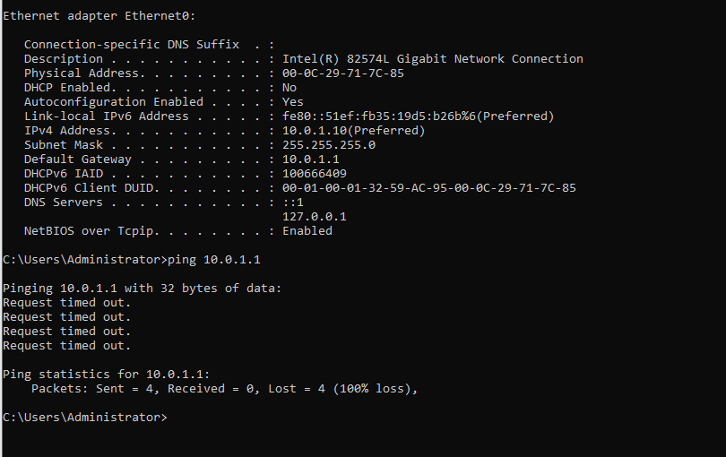
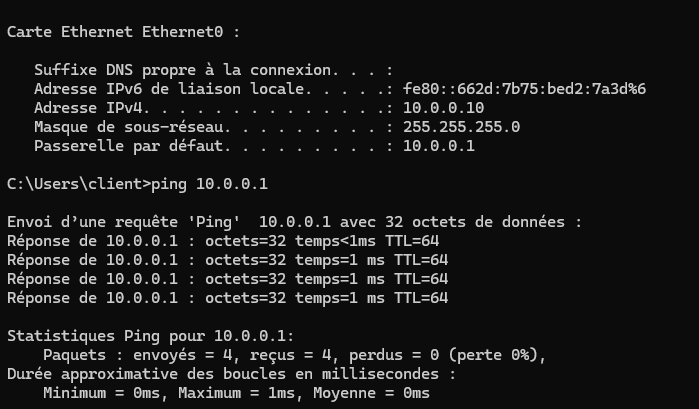
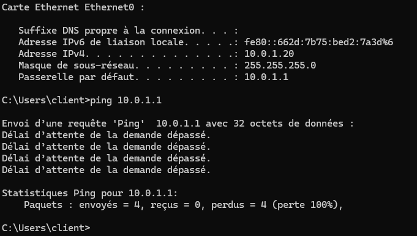
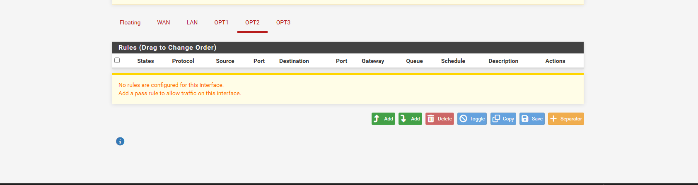
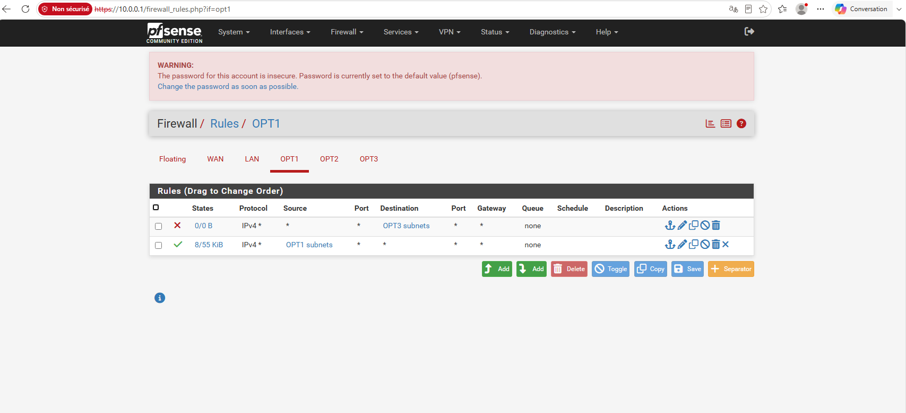
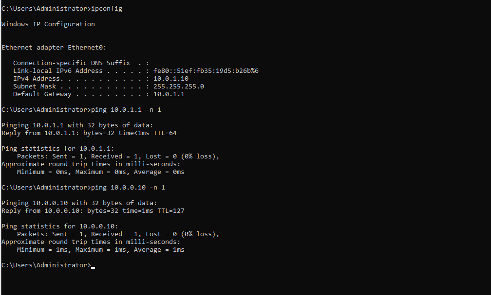

Toutes les interfaces de mon routeur sont configurées.
Le client a une adresse IP.
Mon contrôleur de domaine a également une adresse IP. Cependant, ce dernier ne peut pas ping les autres machines : 

Mon premier poste client ainsi que mon routeur sont eux en capacité de le ping avec une réponse et de se ping entre eux : 

J'ai donc vérifié que le pare-feu Windows autorisait bien le trafic sortant **« Echo Request - ICMPv4-Out »**. La règle entrante **« Echo Request - ICMPv4-In »** était déjà activée, puisque le DC répondait aux pings provenant d'autres machines.

Après avoir écarté un problème lié aux machines et à leurs pare-feu, mon diagnostic m'a amené à suspecter le routeur, et plus particulièrement le sous-réseau dédié aux serveurs : **10.0.1.0/24**.

Pour vérifier cette hypothèse, j'ai connecté mon client au VMnet correspondant à ce sous-réseau, puis modifié son adresse IP en conséquence. Le résultat était identique : **impossible d'effectuer un ping vers le routeur**.

Cela m'a permis de vérifier que l'incident était dû à la configuration de mes sous-réseaux.
Je me suis alors rendu sur l'interface de configuration de mon routeur. En effet, par défaut il n'y avait aucune règle d'autorisatoin présente pour mes interfaces "OPT" ce qui n'était pas le cas pour le LAN (j'utilise les OPT et Lan de la même façon dans ce lab)

J'ajoute alors des règles d'un seul côté (car le pare-feu est stateful) sur chacun des OPT sauf pour ma DMZ, où je bloque toutes les connexions.

L'incident est résolu ! 

