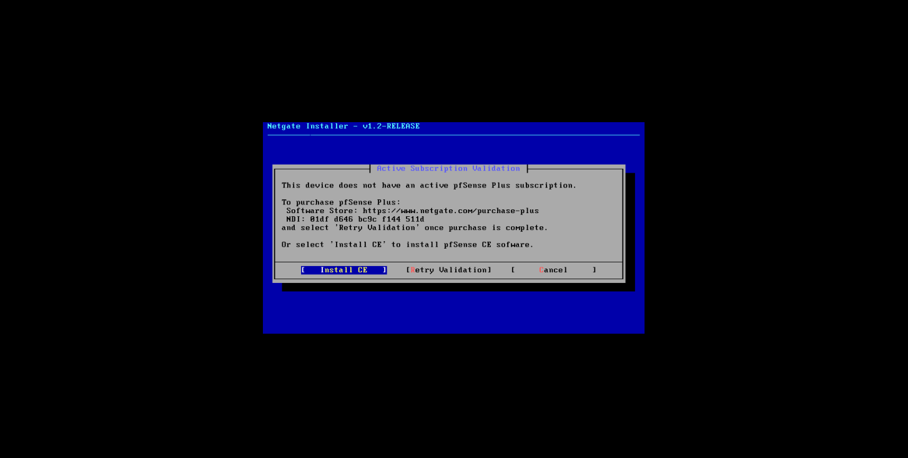
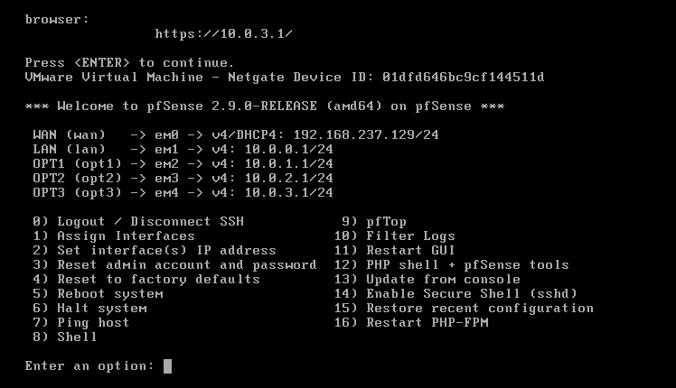

# Installation et configuration de pfSense

Cette configuration fait suite à la [préparation des réseaux et des interfaces dans VMware](configuration-vmware.md).

## Installation de pfSense CE

L'installateur propose l'option **Install CE** pour installer pfSense Community Edition.

## Interfaces et adresses dans pfSense

La console pfSense affiche les interfaces WAN, LAN et OPT ainsi que leurs adresses IP.

## Règles de pare-feu

Les règles d'autorisation ci-dessous ont été ajoutées sur OPT1 et OPT2 : elles n'étaient pas présentes par défaut sur cette interface.

Le diagnostic associé est détaillé dans [Problème de ping depuis DC01](../problemes-rencontres/ping-dc.md).
