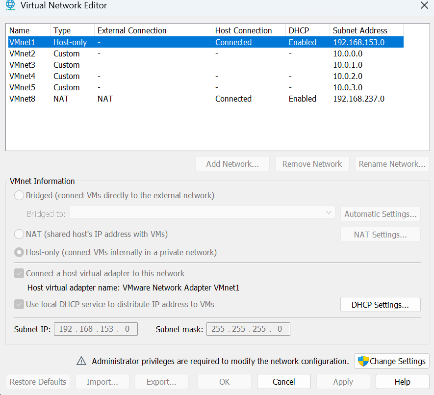
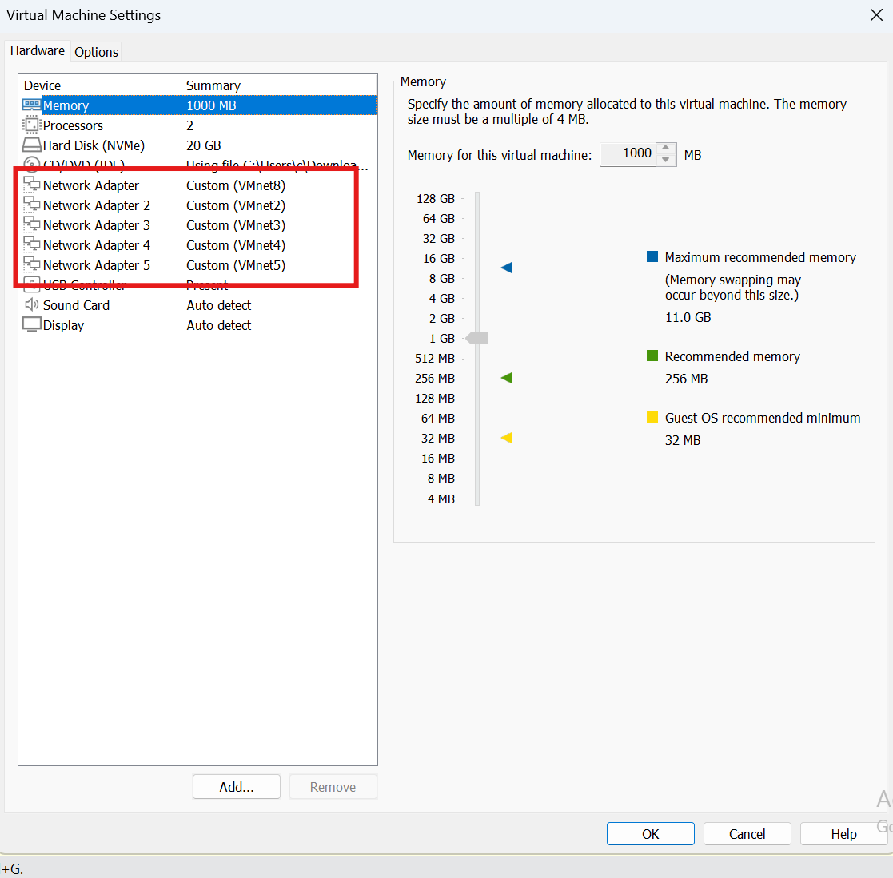

# Configuration réseau VMware

## Objectif

VMware Workstation est utilisé pour héberger les machines virtuelles du lab.

Les réseaux virtuels permettent de séparer les différents sous-réseaux
de l'infrastructure avant leur interconnexion par pfSense.

## Réseaux virtuels

Les sous réseaux sont matérialisés par des réseaux virtuels VMnet. Chaque réseau VMnet représente un switch. Des VLAN ainsi qu'un switch seront peut être utilisés plus tard pour rendre le tout plus clair.

| VMnet | Usage | Réseau | Masque | DHCP VMware |
|---|---|---|---|---|
| VMnet2 | Postes | 10.0.0.0/24 | 255.255.255.0 | Désactivé |
| VMnet3 | Serveurs | 10.0.1.0/24 | 255.255.255.0 | Désactivé |
| VMnet4 | Administration | 10.0.2.0/24 | 255.255.255.0 | Désactivé |
| VMnet5 | DMZ | 10.0.3.0/24 | 255.255.255.0 | Désactivé |

Les réseaux internes sont configurés en Host-only.

L'adaptateur virtuel de l'hôte est désactivé afin que la machine
physique ne soit pas directement connectée aux réseaux internes du lab.

Le service DHCP de VMware est désactivé afin que l'attribution des
adresses IP soit gérée par l'infrastructure du lab.

## Accès WAN

L'interface WAN de pfSense utilise le réseau NAT de VMware (VMnet8).

Cela permet à pfSense d'accéder à Internet sans exposer directement
la machine virtuelle sur le réseau physique.

## Configuration pfSense dans VMware

La machine virtuelle pfSense possède plusieurs interfaces réseau :

| Interface VMware | Réseau | Rôle |
|---|---|---|
| Network Adapter 1 | VMnet8 (NAT) | WAN |
| Network Adapter 2 | VMnet2 | Postes |
| Network Adapter 3 | VMnet3 | Serveurs |
| Network Adapter 4 | VMnet4 | Administration |
| Network Adapter 5 | VMnet5 | DMZ |

## Captures

### Configuration des réseaux virtuels

### Interfaces réseau de pfSense

La suite se trouve dans [Installation et configuration de pfSense](configuration-pfsense.md).
