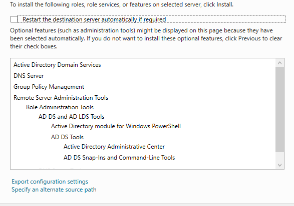

# Installation et configuration d'Active Directory

## Installation d'AD DS

- J'ouvre **Server Manager** sur DC01.
- Je sélectionne **Add Roles and Features**.
- J'installe le rôle **AD DS (Active Directory Domain Services)**.

## Configuration d'Active Directory

- Je sélectionne **Promote this server to a domain controller**.
- Je crée une nouvelle forêt Active Directory nommée **lab.dom**.
- Je sélectionne les niveaux fonctionnels **Windows Server 2016** pour la forêt et le domaine.
- Je conserve le rôle **DNS** et le **catalogue global (GC)**.
- Je définis le mot de passe **DSRM**, utilisé pour la restauration des services d'annuaire.
- Je vérifie le nom NetBIOS du domaine.
- Je conserve les emplacements par défaut de la base de données AD DS et de SYSVOL.
- Je vérifie les prérequis, puis je lance l'installation.
- Je laisse DC01 redémarrer pour terminer la promotion.

