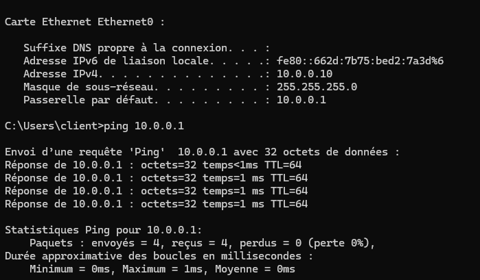
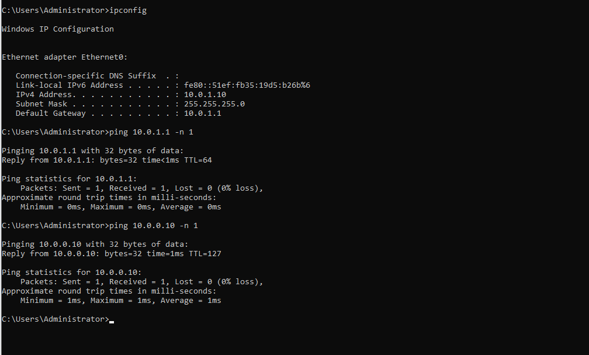
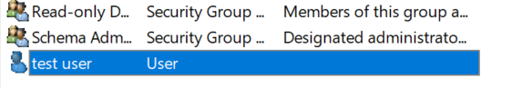
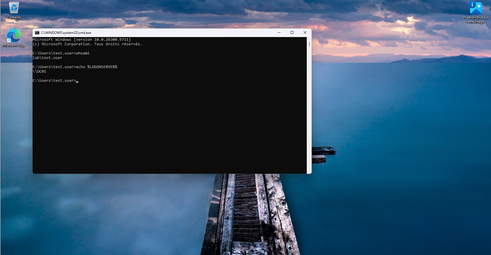

Je vais suivre ce cheminement : 

- [x] Créer une nouvelle VM sous Windows 11 Pro
- [x] Pinger le routeur
- [x] Pinger le DC
- [x] Ajouter le DC en tant que serveur DNS (pour pouvoir résoudre lab.dom)
- [x] Ajouter le port du routeur comme passerelle 
- [x] Joindre le domaine

- [x] Vérifier que CLIENT01 apparaît dans Active Directory
- [x] Vérifier la résolution DNS du domaine avec nslookup
- [x] Se connecter à CLIENT01 avec un compte du domaine
- [x] Créer un utilisateur Active Directory et tester sa connexion
- [x] Vérifier le contrôleur de domaine utilisé avec echo %LOGONSERVER%
- [x] Vérifier la communication entre CLIENT01 et DC01
- [ ] Créer une OU et y déplacer CLIENT01
- [ ] Créer une première GPO et vérifier son application avec gpresult /r

## Captures

### Ping du routeur depuis le client

Le client joint sa passerelle `10.0.0.1`.

### Communication entre DC01 et le client

Depuis DC01 (`10.0.1.10`), les pings vers la passerelle `10.0.1.1` et le client `10.0.0.10` réussissent.

### Création d'un utilisateur de test dans Active Directory

L'utilisateur « test user » apparaît dans Active Directory.

### Connexion avec le compte du domaine et contrôleur utilisé

Dans la session du client, `whoami` renvoie `lab\test.user` et `echo %LOGONSERVER%` affiche `\\DC01` : la session utilise le compte du domaine et DC01 comme serveur de connexion.

